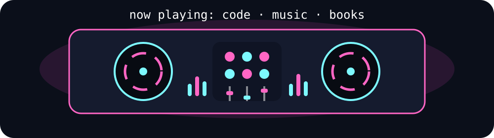

  

# Hi, I'm Trang.

**Mathematics @ Georgia State University**  
Physics Minor | Computational Astrophysics | Scientific Computing

I like mathematics, orbital dynamics, and writing code that makes my life slightly less inconvenient.

Currently exploring the intersection of **mathematics, physics, and computation**, particularly how numerical simulations can help us understand the long-term behavior of astronomical systems.

---

## What I'm Into

- **Mathematics:** Differential equations, numerical methods, probability, and mathematical modeling
- **Astrophysics:** Orbital dynamics, gravitational interactions, and long-term orbital stability
- **Scientific Computing:** Numerical simulations, data analysis, and computational modeling
- **Software Development:** Building practical tools, command-line utilities, and desktop applications
- **Creative Coding:** Music, audio experiments, and interactive systems

### Currently Exploring

- N-body gravitational simulations
- Planetary and exoplanetary orbital dynamics
- Numerical integration and computational methods
- Python for scientific research
- Rust and TypeScript for desktop applications

---

## Tech Stack

### Programming Languages

  

### Scientific Computing & Data

  
  
  
  

### Tools

    
  

---

## Projects

### Orbital Dynamics Simulations - UPCOMING
**Computational Astrophysics | Python · REBOUND · NumPy · Matplotlib**

Exploring gravitational interactions and orbital behavior through numerical simulations.

- Modeling Sun–Earth–Moon gravitational systems
- Visualizing trajectories and orbital inclination in 2D and 3D
- Investigating orbital evolution and dynamical stability
- Exploring extensions involving exomoons, stellar encounters, and multi-body systems

### [Cmdlet](https://github.com/tranguyeenn/cmdlet)
**macOS Command Palette | Rust · TypeScript · Tauri**

A lightweight, keyboard-driven desktop utility for executing commands without navigating through multiple applications.

- Built with Tauri 2, Rust, TypeScript, and Vite
- Global keyboard shortcut and command-based interface
- Finder integration for file operations
- File moving with destination aliases, conflict handling, and undo
- Designed around fast interactions and minimal overhead

### Shelftxt
**Book Recommendation System | Python · FastAPI**

A backend-oriented project for organizing and ranking books in a reading list.

- Book management and ranking logic
- API-based architecture
- Exploring personalized recommendation approaches

### Podify
**Spotify CLI Controller | Python · Spotify Web API**

A terminal-based tool for controlling Spotify playback.

- Keyboard-driven playback controls
- Spotify API integration through Spotipy
- Command-line interaction without a graphical interface

--

## Beyond the Terminal

When I'm not working through mathematics or writing code, I'm probably listening to music, or finding another unnecessarily complicated way to automate a minor inconvenience.

I'm particularly interested in the overlap between scientific research, computational tools, and creative problem-solving.

---

## Connect

- **LinkedIn:** [tranguyeenn](https://www.linkedin.com/in/tranguyeenn/)
- **GitHub:** [tranguyeenn](https://github.com/tranguyeenn)
- **Email:** tranguyeenn2007@gmail.com

---

*Most of my projects start because something mildly inconveniences me. Then I spend significantly more time automating it than the original task would have taken.*
